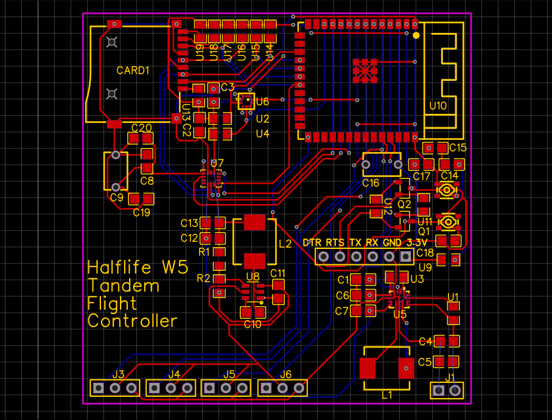
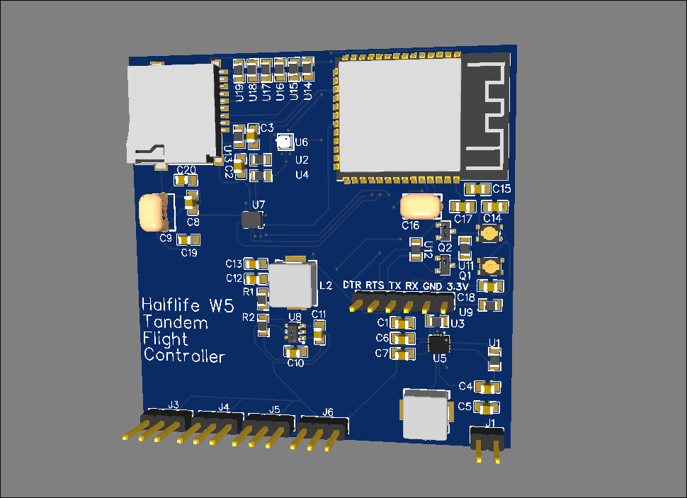

# Tandem Flight Controller 

## What is it ?
This is an esp32-s3 based flight controller built for a tandem aircraft with 2 bldc motors and 2 servos that controll the rotors angle
And stablizes the assembly using an IMU and a Barometer

## Why does it exist ?
I was motivated to make this to challenge myself to see how dense i could make a PCB also im super intersted in PID and TVC systems

## How does it Work ?
When the board powers on it captures its current state as the baseline, then it rises 1.5m off the ground stays there whilst running a webserver REST API that tells the controller where to go next. On idle it just tries to stay stable in its orientation and position

## How would I use it ?
First you'd flash the firmware to the esp32 using an ftdi programmer and maybe calibrate the imu then you'd set it programmatically in flight mode reflash the firmwware and put it on the ground, then power it up> it will boot fly ~1.5m then respond to the clients requests and move accordingly.

## Bill of Materials
| ID | Name                    | Quantity | Manufacturer Part      | Manufacturer  | Supplier | Supplier Part | Price | Link                                               |
|----|-------------------------|----------|------------------------|---------------|----------|---------------|-------|----------------------------------------------------|
| 1  | 100nF                   | 25       | C0805B104K500NT        | TORCH(火炬)     | LCSC     | C476766       | 0.011 | https://www.lcsc.com/product-detail/C476766.html   |
| 2  | 10uF                    | 10       | GRM21BR61C106KE15L     | muRata(村田)    | LCSC     | C77075        | 0.037 | https://www.lcsc.com/product-detail/C77075.html    |
| 3  | 1uF                     | 10       | 178MU0005              | KNSCHA(科尼盛)   | LCSC     | C5632429      | 0.053 | https://www.lcsc.com/product-detail/C5632429.html  |
| 4  | TF-115-BCP9             | 5        | TF-115-BCP9            | XUNPU(讯普)     | LCSC     | C720505       | 0.104 | https://www.lcsc.com/product-detail/C720505.html   |
| 5  | HDR-M-2.54_1x2          | 20       |                        |               | LCSC     | C124375       | 0.028 | https://www.lcsc.com/product-detail/C124375.html   |
| 6  | HDR-M-2.54_1x6          | 10       |                        |               | LCSC     | C190819       | 0.044 | https://www.lcsc.com/product-detail/C190819.html   |
| 7  | HDR-M-2.54_1x3          | 5        |                        |               | LCSC     | C180248       | 0.257 | https://www.lcsc.com/product-detail/C180248.html   |
| 8  | 1.5uH                   | 5        | FXL0630-1R5-M          | cjiang(长江微电)  | LCSC     | C167217       | 0.17  | https://www.lcsc.com/product-detail/C167217.html   |
| 9  | L8050QLT1G              | 50       | L8050QLT1G             | LRC(乐山无线电)    | LCSC     | C49581        | 0.02  | https://www.lcsc.com/product-detail/C49581.html    |
| 10 | 100kΩ                   | 100      | HRC0805J104 FNTN       | HC(华橙熊猫)      | LCSC     | C54921247     | 0.002 | https://www.lcsc.com/product-detail/C54921247.html |
| 11 | 22.1kΩ                  | 100      | FRC0805F2212TS         | FOJAN(富捷)     | LCSC     | C2930182      | 0.003 | https://www.lcsc.com/product-detail/C2930182.html  |
| 12 | 10kΩ                    | 100      | FRC0805F1002TS         | FOJAN(富捷)     | LCSC     | C2907219      | 0.002 | https://www.lcsc.com/product-detail/C2907219.html  |
| 13 | RKCGG140GSMTRLFS        | 2        | RKCGG140GSMTRLFS       | C&K           | LCSC     | C2927791      | 0.485 | https://www.lcsc.com/product-detail/C2927791.html  |
| 14 | TPS63070RNMR            | 1        | TPS63070RNMR           | TI(德州仪器)      | LCSC     | C109322       | 1.236 | https://www.lcsc.com/product-detail/C109322.html   |
| 15 | BMP580                  | 1        | BMP580                 | Bosch(博世)     | LCSC     | C22391138     | 1.214 | https://www.lcsc.com/product-detail/C22391138.html |
| 16 | BMI270                  | 1        | BMI270                 | Bosch(博世)     | LCSC     | C2836813      | 2.62  | https://www.lcsc.com/product-detail/C2836813.html  |
| 17 | LMR51430XDDCR           | 1        | LMR51430XDDCR          | TI(德州仪器)      | LCSC     | C5185863      | 0.791 | https://www.lcsc.com/product-detail/C5185863.html  |
| 18 | ESP32-S3-WROOM-1(N16R8) | 1        | ESP32-S3-WROOM-1-N16R8 | ESPRESSIF(乐鑫) | LCSC     | C2913202      | 5.407 | https://www.lcsc.com/product-detail/C2913202.html  |
| 18 | BLDC and ESC unit       | 2        |                        |               | Amazon   | B0DGXVRT1W    | 16.99 | https://www.amazon.de/-/en/gp/product/B0DGXVRT1W   |
